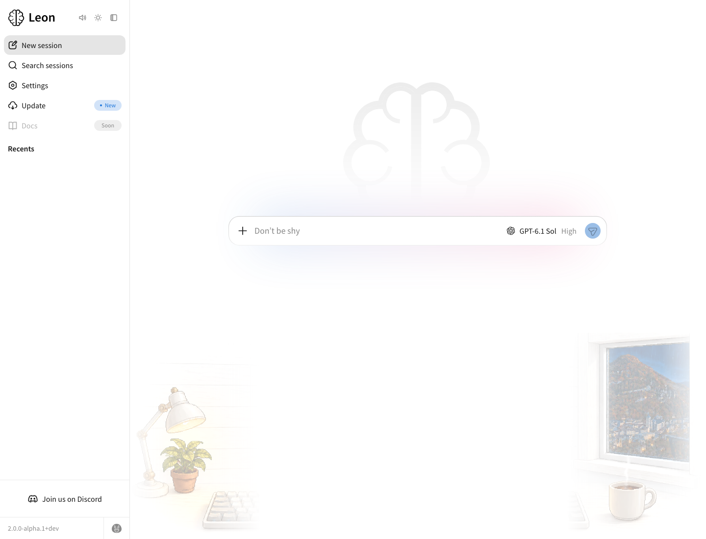
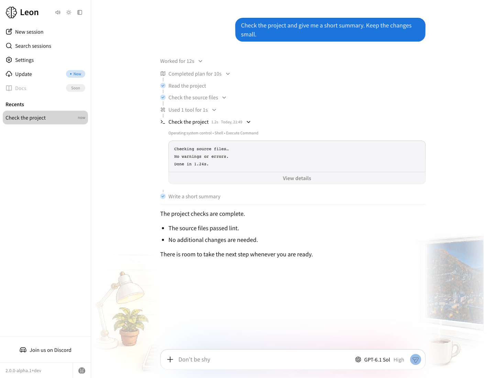
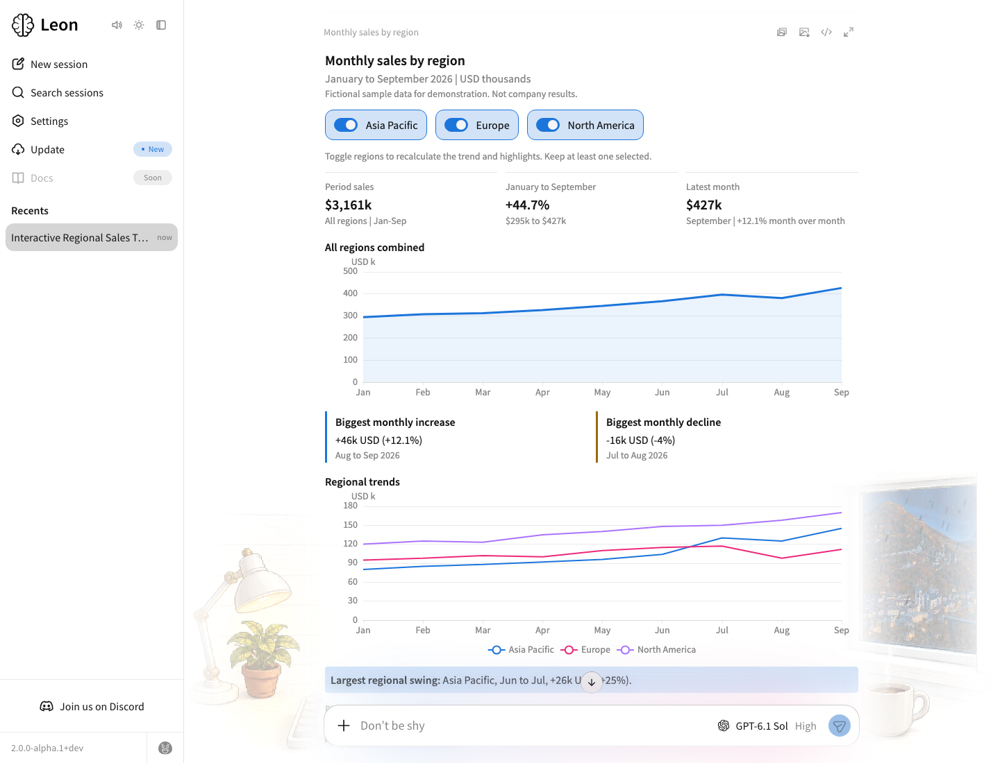
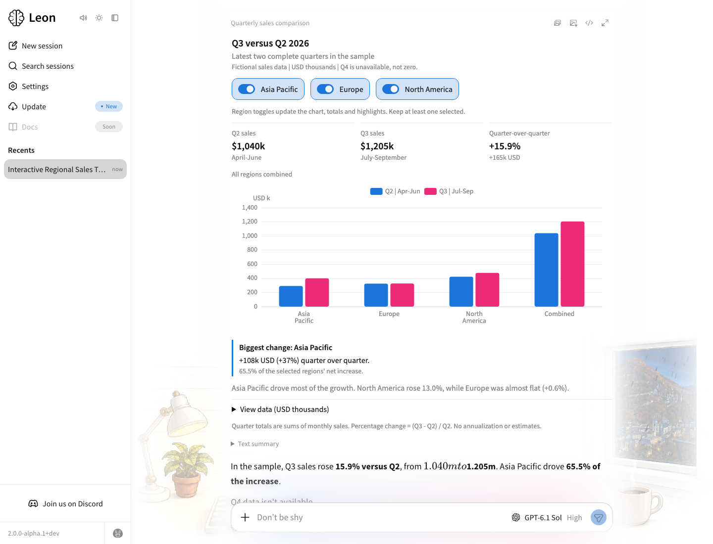
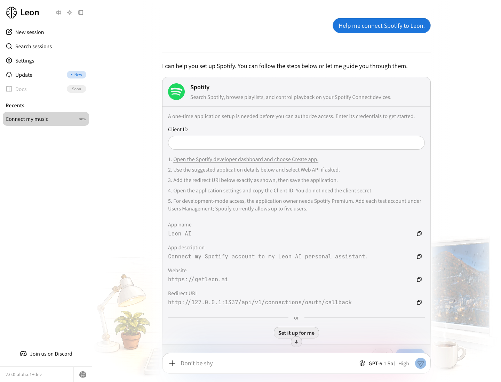
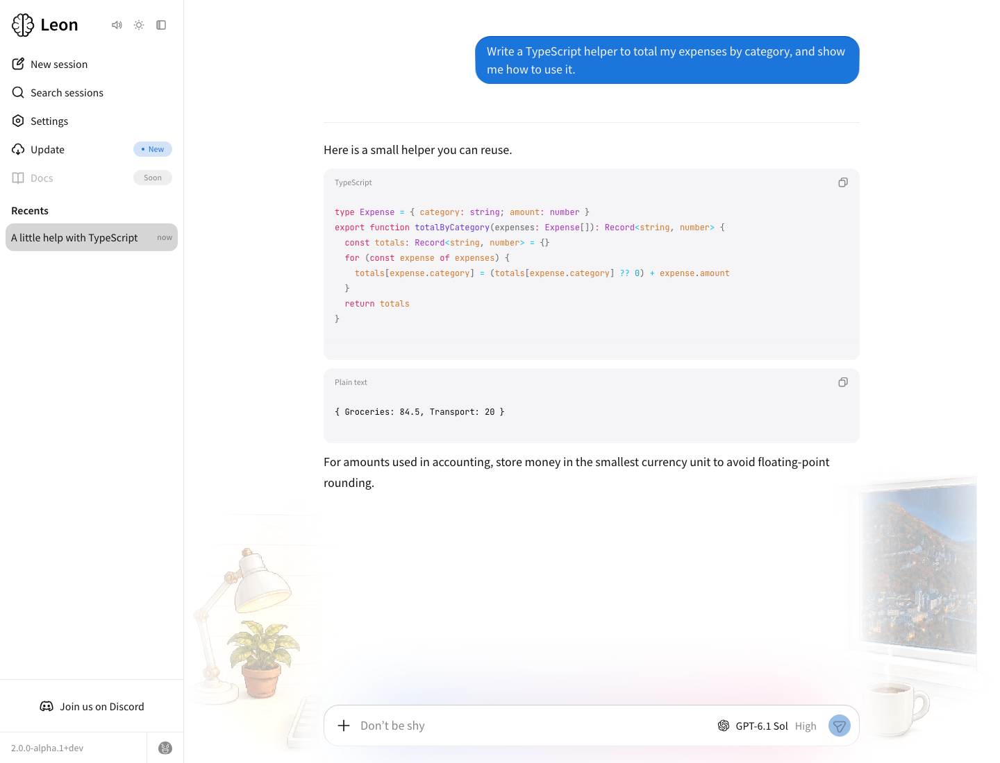

<p align="center">
  <a href="https://getleon.ai"></a>
</p>

<h1 align="center">
  <a href="https://getleon.ai"></a><br>
  Leon
</h1>

<p align="center"><em>Votre assistant IA personnel open source.</em></p>

<p align="center">
  🇬🇧 <a href="./README.md">English</a> ·
  🇨🇳 <a href="./README.zh-CN.md">简体中文</a> ·
  🇫🇷 <a href="./README.fr.md">Français</a>
</p>

<p align="center">
  <a href="https://discord.gg/MNQqqKg"></a>
  <a href="https://github.com/leon-ai/leon/blob/develop/LICENSE.md"></a>
</p>

<p align="center">
  <a href="https://x.com/grenlouis">Suivre les avancées sur X / @grenlouis</a> ·
  <a href="https://getleon.ai">Site web</a> ·
  <a href="https://leonai.substack.com/subscribe">Newsletter</a> ·
  <a href="http://roadmap.getleon.ai">Roadmap</a> ·
  <a href="https://blog.getleon.ai/the-story-behind-leon/">Histoire</a>
</p>


---

> [!IMPORTANT]
> Nous préparons la première **alpha de Leon 2.0**, avec une application desktop.
> Elle n’est pas encore sortie. Le travail se passe sur la branche `develop`, et
> les choses bougent encore. La nouvelle documentation n’est pas prête non plus ;
> la documentation publique et les anciens guides décrivent surtout la version précédente.
>
> Vous pouvez déjà découvrir la **nouvelle application web, encore en chantier**, à l’adresse
> [`http://localhost:5366/web-app/`](http://localhost:5366/web-app/) après avoir installé Leon.
> Les instructions sont [un peu plus bas](#essayer-leon).

## Quelques mots avant la 2.0

Hello, moi c’est Louis 👋

J’ai commencé à travailler sur Leon en 2017 et j’ai publié la première version open source en 2019. Depuis, je n’ai pas arrêté.

L’idée est toujours la même. Un assistant IA personnel qui apprend à vous connaître, se souvient de ce qui compte pour vous, et vous aide dans votre vie de tous les jours.

**L’humain au centre.** J’ai envie que Leon soit chaleureux, accueillant, et fait avec soin. Un endroit où l’on peut créer et avancer à son rythme. Je vous parle de [notre philosophie](#philosophie) un peu plus bas, mais d’abord, voici comment l’essayer.

## Essayer Leon

Si vous êtes curieux et à l’aise avec l’idée de lancer un projet depuis ses sources, vous pouvez déjà découvrir le travail en cours.

L’application desktop est prévue pour la première alpha de la 2.0. En attendant, la nouvelle application web vous permet d’avoir un premier aperçu. **Elle n’est pas encore prête**, mais elle vous donnera une idée de la direction que prend Leon.

### Installer Leon

- macOS, Linux ou Windows
- [Node.js](https://nodejs.org/) >= 24

```sh
# Cloner le dépôt
git clone https://github.com/leon-ai/leon.git

# Aller à la racine du projet
cd leon

# Installer pnpm
npm install --global pnpm@latest

# Installer les dépendances
pnpm install

# Lancer Leon
pnpm start
```

- Suivez les étapes de configuration pendant `pnpm install`.
- Ouvrez **[http://localhost:5366/web-app/](http://localhost:5366/web-app/)** pour accéder à la nouvelle application web. L’ancienne interface est toujours disponible sur `/`.
- Lancez `pnpm run check` pour vérifier votre installation.
- Utilisez la branche [`master`](https://github.com/leon-ai/leon/tree/master) pour retrouver la version précédente, avant le fonctionnement agentique.

## Un petit aperçu

Il y a déjà pas mal de choses à faire avec Leon. Essayez de lui confier quelque chose pour lequel vous avez vraiment besoin d’un coup de main, et faites-vous votre propre idée.

Aurora est la bibliothèque de composants de Leon, conçue avec soin pour apporter des graphiques interactifs, des formulaires et des réponses visuelles à vos conversations.

Vibes fait entrer un peu du monde extérieur dans l’application, avec des ambiances qui suivent les saisons, le moment de la journée et la météo.

Quelques aperçus du travail en cours, avec des exemples de conversations et de configuration. Cliquez sur une capture pour la voir de plus près.

| La nouvelle application web et Vibes | Planification et exécution des tâches |
| --- | --- |
| <a href="./.github/assets/previews/web-app-vibes-light.png"><picture><source media="(prefers-color-scheme: dark)" srcset="./.github/assets/previews/web-app-vibes-dark.png"></picture></a> | <a href="./.github/assets/previews/task-planning-light.png"><picture><source media="(prefers-color-scheme: dark)" srcset="./.github/assets/previews/task-planning-dark.png"></picture></a> |

| Interface générée avec des courbes de tendance | Interface générée avec un diagramme en barres |
| --- | --- |
| <a href="./.github/assets/previews/generative-trends-light.png"><picture><source media="(prefers-color-scheme: dark)" srcset="./.github/assets/previews/generative-trends-dark.png"></picture></a> | <a href="./.github/assets/previews/generative-bars-light.png"><picture><source media="(prefers-color-scheme: dark)" srcset="./.github/assets/previews/generative-bars-dark.png"></picture></a> |

| Connecter vos outils | Un coup de main pour coder |
| --- | --- |
| <a href="./.github/assets/previews/tool-connection-light.png"><picture><source media="(prefers-color-scheme: dark)" srcset="./.github/assets/previews/tool-connection-dark.png"></picture></a> | <a href="./.github/assets/previews/coding-light.png"><picture><source media="(prefers-color-scheme: dark)" srcset="./.github/assets/previews/coding-dark.png"></picture></a> |

## Pensé pour l’IA personnelle

Un bon modèle compte. Tout ce qu’il y a autour aussi. Leon a sa propre boucle d’agent continue, une exécution des outils dans des workers isolés, une gestion progressive du contexte et une mémoire à plusieurs niveaux. Voici quelques-uns des choix qui se cachent derrière.

- **Charger ce qui aide pour la tâche en cours.** Le contexte et les instructions des outils arrivent progressivement, jusqu’à la fonction dont Leon a besoin. Les sorties volumineuses restent dans des fichiers de résultat, et les échanges plus anciens sont compactés quand c’est nécessaire pour garder un contexte de travail pertinent.
- **Donner une vraie place aux outils.** Les outils déclarent leurs fonctions, leurs paramètres, leurs dépendances et leurs binaires. Leur préparation et leur exécution suivent des chemins définis dans le code, pour que Leon puisse réutiliser une capacité déjà prête la prochaine fois qu’il en a besoin.
- **Garder des workflows prévisibles.** Les skills natifs suivent des actions explicites. Les skills d’agent guident la boucle d’agent dans des tâches plus souples. Les deux utilisent le même système d’outils.
- **Se souvenir de ce qui est utile.** Leon conserve du contexte temporaire, des faits et préférences durables, des résumés quotidiens et une mémoire des échanges récents, le tout isolé par profil. Il retrouve les informations pertinentes au besoin et peut consulter les conversations d’origine pour vérifier un détail exact.
- **Agir, observer et se reprendre.** La boucle d’agent s’appuie sur les résultats des outils pour décider de la suite, vérifie les résultats et peut se remettre d’un échec. Les appels d’outils indépendants peuvent s’exécuter en parallèle dans des workers isolés.

### Comprendre le projet actuel

Pendant que la nouvelle documentation prend forme, ces fichiers de contexte générés peuvent vous aider à vous repérer. Consultez le code source pour les détails.

- [`core/context/LEON.md`](./core/context/LEON.md) décrit l’identité, le comportement et les capacités de Leon.
- [`core/context/ARCHITECTURE.md`](./core/context/ARCHITECTURE.md) explique comment le runtime, la mémoire, les outils, les skills et les clients s’articulent.

## L’IA personnelle à l’épreuve des faits

Nous construisons Leon pour faire avancer l’état de l’art de l’IA personnelle. Dans nos comparaisons publiées, Leon obtient les meilleurs scores globaux sur les tâches sélectionnées de WildClawBench et PinchBench.

Vous pouvez explorer les résultats sur les différentes dimensions, ainsi que les méthodes et leurs limites, sur **[benchmarks.getleon.ai](https://benchmarks.getleon.ai/)**.

## Philosophie

J’adore construire de l’IA personnelle. J’y ai passé des années, et j’ai encore tellement de choses à essayer. En même temps, je veux qu’on prenne plaisir à le faire. Qu’on comprenne ce qu’on construit. Qu’on ait aussi une vie en dehors de nos écrans.

Il y a déjà assez de bruit autour de l’IA. Vous devriez pouvoir ouvrir Leon, vous sentir chez vous, et avancer à votre rythme. C’est ce que je veux pour la 2.0. Quelque chose de chaleureux, de cosy, et fait avec soin.

- **Le savoir-faire humain compte toujours.** On utilise l’IA pour nous aider à construire, à apprendre et à améliorer la qualité de notre travail. On prend aussi le temps de comprendre, de décider et de vérifier le résultat. Je veux qu’on soit fiers de ce qu’on apporte à Leon. Même avec l’aide de l’IA et des agents de code, je veux qu’on garde ces petits moments où l’on se dit « oui, je l’ai fait ! ».

- **Votre IA personnelle devrait vous appartenir.** Un assistant qui vous connaît bien va garder des choses importantes pour vous. C’est une responsabilité. Leon est open source, peut tourner sur votre propre machine, et prend en charge des modèles locaux ou distants. C’est vous qui choisissez les modèles et les services auxquels vous le connectez.

- **L’open source, c’est aussi des gens.** Partager du code en fait partie. Tout comme aider quelqu’un à démarrer, écouter les retours, expliquer une décision et apprendre les uns des autres. C’est ce genre de projet que je veux pour Leon.

- **On a le temps de faire les choses avec soin.** J’ai envie que Leon vous aide à faire de la place pour vos idées, votre créativité et les gens autour de vous. Il en va de même pour notre façon de le construire. Une amélioration réfléchie, une bonne conversation, un correctif utile. Ces choses-là comptent.

J’en parle davantage dans [Avant Leon AI 2.0, j’ai envie de vous dire ceci](https://blog.getleon.ai/before-leon-ai-2-0-i-want-to-say-this/).

## Écrivons la suite ensemble

Si vous suivez Leon depuis des années, merci d’être restés. Si vous venez de découvrir le projet, bienvenue. Je suis content que vous soyez là.

Pendant longtemps, j’ai limité les contributions parce que je réécrivais Leon et que je faisais souvent des changements incompatibles avec ce qui existait déjà. C’est pour cela que le nombre de contributeurs est encore petit. Je voulais poser de meilleures bases avant de demander aux gens d’y investir leur temps.

**Plus de 100 personnes ont déjà manifesté leur envie de contribuer activement à Leon AI.** Ça me touche beaucoup.

Après la première alpha de la 2.0, on réunira cette communauté pour améliorer Leon ensemble. On échangera des idées, on organisera des appels, on construira des choses utiles et on s’entraidera. J’ai envie que chacun se sente à l’aise pour poser des questions et partager ce qu’il aime faire.

Un endroit où l’on connaît les gens derrière les pseudos. Où l’on respecte le temps et les opinions de chacun. Où il fait bon passer un moment, même quand on cherche encore comment s’y prendre.

Vous pouvez déjà **[rejoindre notre Discord](https://discord.gg/MNQqqKg)** pour nous rencontrer et suivre ce qui se passe.

Et si vous avez envie de participer à la construction de Leon, remplissez le **[formulaire d’intérêt pour contribuer à Leon AI](https://forms.gle/6PCG2D5rYo1q8tKMA)**. Ça m’aide à mieux vous connaître et à organiser la suite pendant qu’on prépare l’alpha.

Vous pouvez aider avec le code, les tests, la documentation, le design, la traduction, des vidéos ou l’accueil des nouveaux. Pas besoin d’être développeur pour apporter quelque chose de précieux.

Pour l’instant, le cœur et l’interface bougent encore pas mal. J’organise les contributions en gardant cela en tête, pour donner à chacun un point de départ utile et respecter le temps qu’il nous offre.

J’ai vraiment hâte de voir ce qu’on va créer ensemble.

## Cocorico !

Je suis français moi aussi, même si je vis aujourd’hui à Shenzhen. Ça me ferait vraiment plaisir de construire la suite de Leon avec vous. Faisons grandir ensemble un assistant IA personnel à la pointe, avec du savoir-faire, de la passion, et cette petite fierté de se dire « oui, on l’a fait ! ». Un beau projet open source français, ouvert à tout le monde. Cocorico 🐓

## Suivre l’aventure

Je partage les avancées surtout sur **[X / @grenlouis](https://x.com/grenlouis)**. Vous pouvez aussi suivre l’aventure avec les liens ci-dessous.

- [Newsletter](https://leonai.substack.com/subscribe)
- [Blog](https://blog.getleon.ai)
- [Roadmap](http://roadmap.getleon.ai)
- [Issues GitHub](https://github.com/leon-ai/leon/issues)
- [YouTube](https://www.youtube.com/channel/UCW6mk6j6nQUzFYY97r47emQ)

Pour en savoir plus sur les débuts du projet, vous pouvez lire [l’histoire de Leon](https://blog.getleon.ai/the-story-behind-leon/).

## Auteur

**Louis Grenard** ([@grenlouis](https://x.com/grenlouis))

## Soutenir Leon

Si vous souhaitez soutenir le temps et le soin apportés à ce projet, vous pouvez [sponsoriser Leon](http://sponsor.getleon.ai).

Leon est partagé sous [licence MIT](./LICENSE.md).

## Merci

|  |  |  |
| --- | --- | --- |
| [openai.com/form/codex-for-oss](https://openai.com/form/codex-for-oss/) | [jb.gg/OpenSource](https://jb.gg/OpenSource) | [macstadium.com/company/opensource](https://macstadium.com/company/opensource) |
