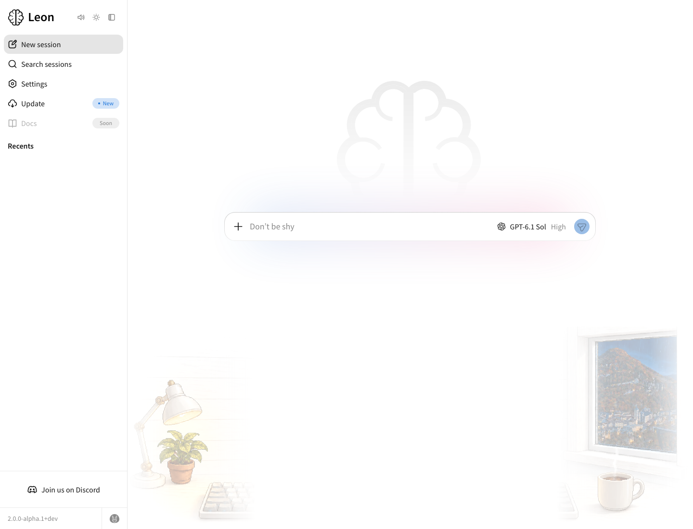
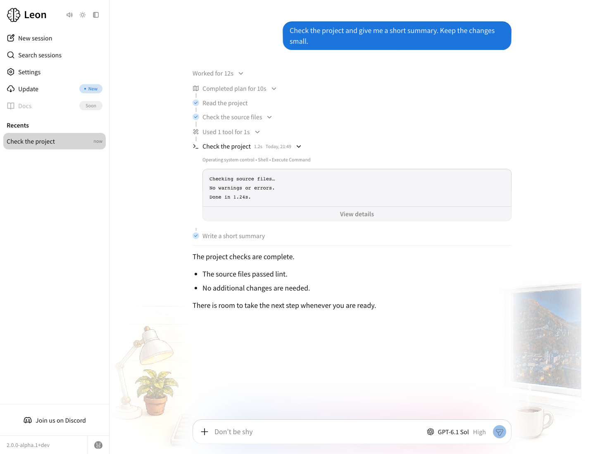
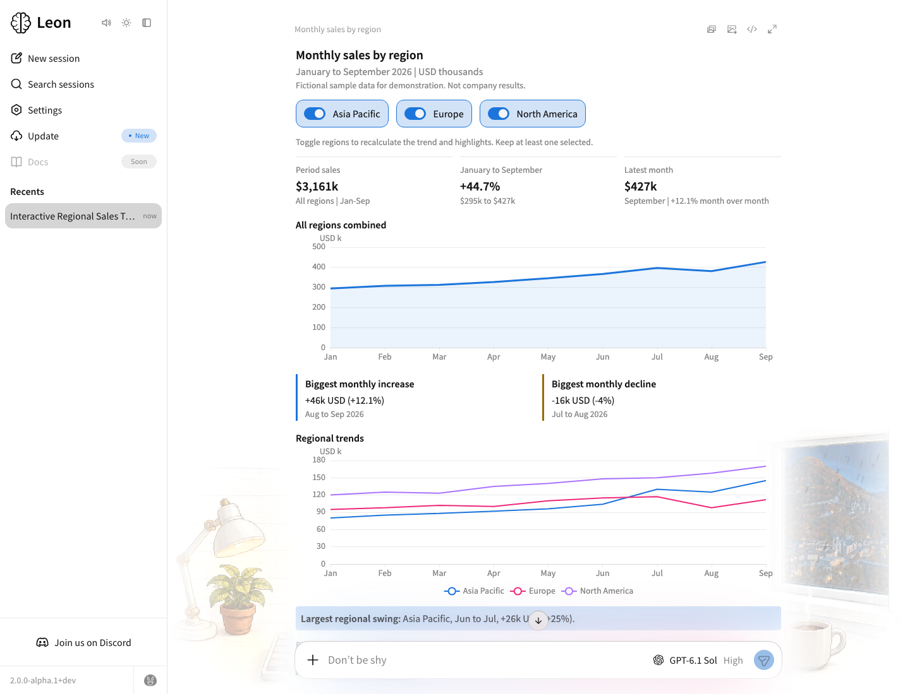
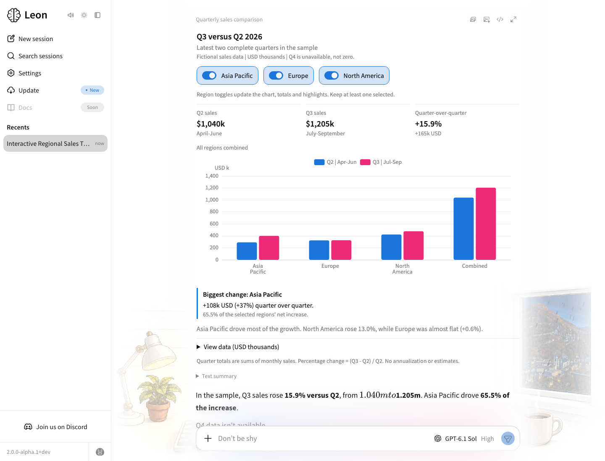
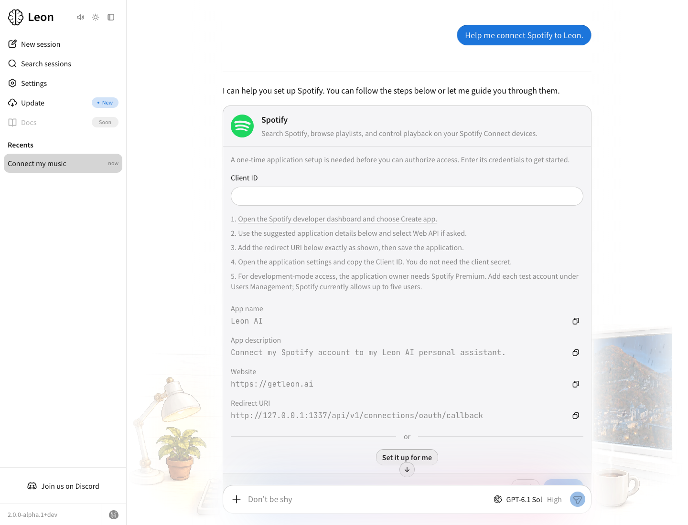
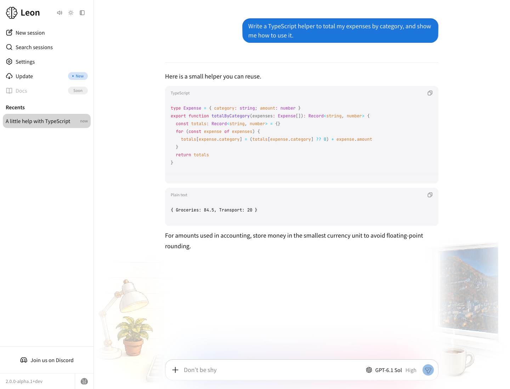

<p align="center">
  <a href="https://getleon.ai"></a>
</p>

<h1 align="center">
  <a href="https://getleon.ai"></a><br>
  Leon
</h1>

<p align="center"><em>你的开源个人 AI 助手。</em></p>

<p align="center">
  <a href="./README.md">English</a> ·
  <a href="./README.zh-CN.md">简体中文</a> ·
  <a href="./README.fr.md">Français</a>
</p>

<p align="center">
  <a href="https://discord.gg/MNQqqKg"></a>
  <a href="https://github.com/leon-ai/leon/blob/develop/LICENSE.md"></a>
</p>

<p align="center">
  <a href="https://x.com/grenlouis">在 X 上关注进展 / @grenlouis</a> ·
  <a href="https://getleon.ai">官网</a> ·
  <a href="https://leonai.substack.com/subscribe">邮件订阅</a> ·
  <a href="http://roadmap.getleon.ai">路线图</a> ·
  <a href="https://blog.getleon.ai/the-story-behind-leon/">背后的故事</a>
</p>


---

> [!IMPORTANT]
> 我们正在准备首个 **Leon 2.0 alpha 版本**，届时会带来桌面应用。
> 这个版本还没有发布。目前的开发工作都在 `develop` 分支上，很多地方仍在变化。
> 新文档也还没有准备好；公开的文档站和旧指南大多介绍的是上一代版本。
>
> 安装并启动 Leon 后，你已经可以在本地访问
> [`http://localhost:5366/web-app/`](http://localhost:5366/web-app/)，
> 提前体验**尚未完成的新网页应用**。具体步骤在[下方](#体验预览版)。

## 2.0 发布前，想说几句话

你好，我是 Louis 👋

我从 2017 年开始开发 Leon，在 2019 年发布了第一个开源版本。之后就一直做到了现在。

最初的想法一直没变。做一个会慢慢了解你、记住你在意的事，并在日常生活中帮上忙的个人 AI 助手。

**把人放在中心。** 我希望 Leon 是一个温暖、舒服、用心打磨的地方。你可以在这里创造，也可以按照自己的节奏慢慢来。后面会多聊一点[我们的理念](#理念)，不过先来看看怎么体验吧。

## 体验预览版

如果你感兴趣，也熟悉从源码运行项目，现在就可以试试我们正在做的东西。

桌面应用计划随首个 2.0 alpha 版本一起发布。在那之前，你可以通过新网页应用先看一看。**它还没有准备好**，但已经能让你感受到 Leon 正在往哪个方向走。

### 安装 Leon

- macOS、Linux 或 Windows
- [Node.js](https://nodejs.org/) >= 24

```sh
# 克隆仓库
git clone https://github.com/leon-ai/leon.git

# 进入项目根目录
cd leon

# 安装 pnpm
npm install --global pnpm@latest

# 安装依赖
pnpm install

# 启动 Leon
pnpm start
```

- 在 `pnpm install` 期间按照提示完成配置。
- 打开 **[http://localhost:5366/web-app/](http://localhost:5366/web-app/)** 体验新网页应用。旧界面仍然可以在 `/` 访问。
- 运行 `pnpm run check` 检查安装情况。
- 如果你想使用还没有引入智能体机制的上一代版本，请切换到 [`master` 分支](https://github.com/leon-ai/leon/tree/master)。

## 先看一看

Leon 已经有不少能帮上忙的地方了。找一件你确实需要帮助的事交给它，亲自试试，感受一下。

Aurora 是专为 Leon 用心打造的组件库，让交互图表、表单和可视化回答融入你的对话。

Vibes 把窗外的世界带进应用，让背景氛围随着季节、一天中的时段和天气变化。

下面是一些开发中的界面预览，使用了示例对话和配置页面。点击截图可以查看大图。

| 新网页应用和 Vibes | 任务规划与执行 |
| --- | --- |
| <a href="./.github/assets/previews/web-app-vibes-light.png"><picture><source media="(prefers-color-scheme: dark)" srcset="./.github/assets/previews/web-app-vibes-dark.png"></picture></a> | <a href="./.github/assets/previews/task-planning-light.png"><picture><source media="(prefers-color-scheme: dark)" srcset="./.github/assets/previews/task-planning-dark.png"></picture></a> |

| 生成式界面与趋势图 | 生成式界面与柱状图 |
| --- | --- |
| <a href="./.github/assets/previews/generative-trends-light.png"><picture><source media="(prefers-color-scheme: dark)" srcset="./.github/assets/previews/generative-trends-dark.png"></picture></a> | <a href="./.github/assets/previews/generative-bars-light.png"><picture><source media="(prefers-color-scheme: dark)" srcset="./.github/assets/previews/generative-bars-dark.png"></picture></a> |

| 连接你的工具 | 帮你写点代码 |
| --- | --- |
| <a href="./.github/assets/previews/tool-connection-light.png"><picture><source media="(prefers-color-scheme: dark)" srcset="./.github/assets/previews/tool-connection-dark.png"></picture></a> | <a href="./.github/assets/previews/coding-light.png"><picture><source media="(prefers-color-scheme: dark)" srcset="./.github/assets/previews/coding-dark.png"></picture></a> |

## 为个人 AI 而构建

一个好的模型很重要。围绕它构建的一切也同样重要。Leon 拥有自己的持续智能体循环、在隔离 worker 中执行的工具、渐进式上下文管理和多层记忆。下面是这套设计背后的一些选择。

- **按需加载当前任务需要的内容。** 上下文和工具指引会逐步加载，细化到 Leon 此刻需要调用的函数。较大的工具输出保存在结果文件中，较早的对话会在必要时压缩，让工作上下文保持相关和聚焦。
- **让工具有明确的职责和归属。** 每个工具都声明自己的函数、设置、依赖和二进制程序。准备和执行过程由明确的代码流程负责，这样下一次需要时，Leon 就可以复用已经准备好的能力。
- **保留可预测的工作流。** 原生技能按照明确的动作执行。智能体技能则引导智能体循环处理更灵活的任务。两者使用同一套工具系统。
- **有选择地记住有用的信息。** Leon 保存临时上下文、长期事实与偏好、每日摘要和近期对话记忆，不同配置档案（profile）之间彼此隔离。它会在需要时检索相关记录，也可以查阅原始对话来核实具体细节。
- **行动、观察，并从失败中恢复。** 智能体循环根据工具返回的结果决定下一步，检查实际结果，也能在遇到问题时调整并继续。彼此独立的工具调用可以在隔离的 worker 中并行执行。

### 了解当前的项目

新文档还在编写中。这些自动生成的上下文文件可以帮助你了解项目，具体实现仍请以源码为准。

- [`core/context/LEON.md`](./core/context/LEON.md) 介绍 Leon 的身份、行为和能力。
- [`core/context/ARCHITECTURE.md`](./core/context/ARCHITECTURE.md) 介绍运行时、记忆、工具、技能和客户端如何协作。

## 用实际表现衡量个人 AI

我们希望通过 Leon 推动个人 AI 的前沿发展。在已公开的对比中，Leon 在 WildClawBench 和 PinchBench 所选任务上的综合得分领先。

你可以在 **[benchmarks.getleon.ai](https://benchmarks.getleon.ai/)** 查看不同维度的结果，以及测试方法和局限。

## 理念

我很喜欢做个人 AI。已经花了很多年，也还有好多想尝试的事。同时，我希望我们能享受这个过程。理解自己在做什么。也在屏幕之外，留一点时间给生活。

围绕 AI 的声音已经够嘈杂了。我希望你打开 Leon 时，能感到自在，像回到自己的空间一样，按照自己的节奏慢慢来。这也是我想带给 2.0 的感觉。温暖、舒服，而且能感受到背后的用心。

- **人的手艺依然重要。** 我们用 AI 帮助自己构建、学习，提高作品的质量。同时，也花时间理解、做决定、检查结果。我希望我们能为自己给 Leon 带来的东西感到自豪。即使用着 AI 和编程智能体，也依然能保留那些小小的“耶，我做到了！”的时刻。

- **你的个人 AI 应该属于你。** 一个很了解你的助手，会保存对你很重要的东西。这是一份责任。Leon 是开源的，可以运行在你自己的机器上，也支持本地和远程模型。使用哪些模型、连接哪些服务，都由你来选择。

- **开源也是人与人之间的事。** 分享代码是一部分。帮助别人上手、倾听反馈、解释一个决定、互相学习，也都是。我希望 Leon 成为这样的项目。

- **我们可以花时间，把事情做好。** 我希望 Leon 能为你的想法、创造力和身边的人腾出一点空间。我们构建 Leon 的方式也应该如此。一次认真思考后的改进，一场好的交流，一个实用的修复。这些都很重要。

我在[《在 Leon AI 2.0 之前，我想说几句话》](https://blog.getleon.ai/before-leon-ai-2-0-i-want-to-say-this/)里聊了更多。

## 一起写下接下来的故事

如果你已经关注 Leon 很多年，谢谢你一直都在。如果你刚刚发现这个项目，欢迎。很高兴你能来到这里。

很长一段时间里，我限制了贡献的开放，因为我一直在重写 Leon，经常会做出不兼容的改动。这也是仓库目前贡献者数量还不多的原因。我想先把基础打得更好，再请大家投入自己的时间。

**已经有 100 多位朋友表达了想积极为 Leon AI 做贡献的意愿。** 这对我来说意义很大。

首个 2.0 alpha 版本发布后，我们会把这个社区聚起来，一起改进 Leon。交流想法，组织社区通话，做一些实用的东西，也互相帮帮忙。我希望大家在这里能自在地提问，分享自己用心做的作品。

一个能认识网名背后那些人的地方。尊重彼此的时间和想法。即使还没想好怎么做，也愿意过来坐坐、聊聊。

现在就可以**[加入我们的 Discord](https://discord.gg/MNQqqKg)**，认识大家，看看项目最近在做什么。

如果你也想参与构建 Leon，欢迎填写 **[Leon AI 贡献意向表](https://forms.gle/6PCG2D5rYo1q8tKMA)**。在准备 alpha 版本的这段时间里，这能帮助我了解你，也安排好接下来的事情。

代码、测试、文档、设计、翻译、视频，或是帮助新朋友熟悉项目，都可以。不需要是开发者，你也能带来有价值的东西。

目前，核心和界面仍然变化比较多。我会考虑到这一点来组织贡献，希望给大家找到合适的起点，也尊重每个人愿意付出的时间。

很期待看到我们会一起做出什么。

## 给中国朋友们的一点问候

大家好 👋 我是 Louis，一个住在深圳的法国人。很开心能通过 Leon 认识你们。欢迎来聊聊、分享想法，或者一起做点有意思的东西。希望这里也能让你们感到自在，就像和朋友在一起一样。

## 关注进展

我最常在 **[X / @grenlouis](https://x.com/grenlouis)** 分享开发进展。你也可以通过下面这些地方继续关注。

- [邮件订阅](https://leonai.substack.com/subscribe)
- [博客](https://blog.getleon.ai)
- [路线图](http://roadmap.getleon.ai)
- [GitHub Issues](https://github.com/leon-ai/leon/issues)
- [YouTube](https://www.youtube.com/channel/UCW6mk6j6nQUzFYY97r47emQ)

想了解项目更早的经历，可以看看 [Leon 背后的故事](https://blog.getleon.ai/the-story-behind-leon/)。

## 作者

**Louis Grenard**（[@grenlouis](https://x.com/grenlouis)）

## 支持 Leon

如果你愿意支持投入这个项目的时间与心力，可以[赞助 Leon](http://sponsor.getleon.ai)。

Leon 以 [MIT 许可证](./LICENSE.md) 开源。

## 感谢

|  |  |  |
| --- | --- | --- |
| [openai.com/form/codex-for-oss](https://openai.com/form/codex-for-oss/) | [jb.gg/OpenSource](https://jb.gg/OpenSource) | [macstadium.com/company/opensource](https://macstadium.com/company/opensource) |
